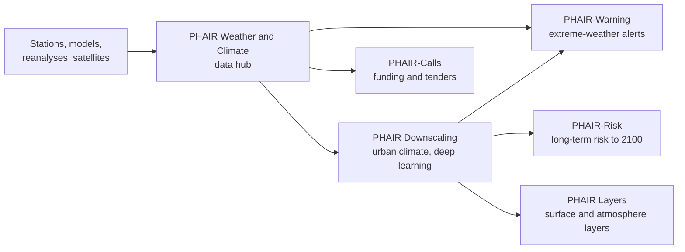

<!-- header -->

  

  

  
  
  
  

 

> I build the data backbone of a climate-risk company: the pipelines that pull in weather observations, forecasts,
> reanalyses and satellite products, the database that holds them, and the apps that turn them into decisions -
> from a street-level heat map to a warning that arrives before the storm does.

 

## Now: the PHAIR-EARTH platform

Since October 2025 I am the Data Engineer at **[PHAIR-EARTH](https://phair-earth.com)** (Physics and AI for a Resilient
Earth), a climate-risk spin-off of the University of Lisbon (Instituto Dom Luiz). In the last months the work grew from one
station pipeline into a **hub-and-spoke platform**: one data hub with several products on top of it. I designed, built and run
the hub and the Warning, Downscaling and Calls apps; Risk and Layers are built by colleagues on the same data.

<table>
<tr>
<td width="50%" valign="top">

### PHAIR Weather and Climate
**The single source of data for every other app.**
Station networks (GHCN, ECA&D, Meteostat, IPMA hourly, INMET...), forecasts (GFS, ECMWF IFS and AIFS, ICON, AROME at
~2.5 km, GEFS and ECMWF ensembles), ERA5 and CERRA reanalyses, MODIS land surface temperature, Sentinel-2 NDVI, CMIP6
scenarios and forecast verification. Maps, series, netCDF cut-outs and an API for the other apps.

`PostgreSQL` `FastAPI` `xarray` `netCDF/HDF5` `Leaflet` `Plotly`

</td>
<td width="50%" valign="top">

### PHAIR-Warning
**Extreme-weather alerts, made to measure for each place.**
Compares several forecast models with each location's 30-year climate and with the official thresholds, by
municipality, up to 5 days ahead: heat, cold, rain and wind. Personal places with sector thresholds, plans,
four languages, a desktop app and a phone web app.

`multi-model ensembles` `climatology` `PWA` `Tauri`

</td>
</tr>
<tr>
<td valign="top">

### PHAIR Downscaling
**The climate of the city, street by street.**
Turned our CTO's research deep-learning downscaler (UCDL) into a product: runs, results, catalogue and reports in one app,
GPU-backed, with cached views that make restarts invisible. The base for selling high-resolution data per km² and
for feeding the other products.

`PyTorch` `deep learning` `SLURM` `SQLite`

</td>
<td valign="top">

### PHAIR-Calls
**Funding calls and tenders, already scored.**
Collects public funding and procurement notices (PT/ES), reads the documents and scores each one 0-100 against the
company profile with an LLM, then puts the decision in cards: stack, funnel and sources.

`LLM evaluation` `scraping` `PDF parsing` `scoring`

</td>
</tr>
</table>

**Shared across all apps:** one PHAIR account with multi-factor sign-in and per-app access (with end dates for
contractors), the same design system in light and dark themes, desktop installers for Windows and macOS built by CI,
SemVer releases with changelogs, automated tests and scheduled pipelines running 24/7 on company hardware.

 

## The last six months in numbers

<table>
<tr>
<td align="center" width="25%"><h1>4</h1>apps in production Weather, Warning, Downscaling, Calls</td>
<td align="center" width="25%"><h1>320+</h1>commits since mid-October, private repos</td>
<td align="center" width="25%"><h1>25</h1>releases Windows and macOS installers</td>
<td align="center" width="25%"><h1>500+</h1>automated tests across the platform</td>
</tr>
<tr>
<td align="center"><h1>17</h1>data connectors stations, models, warnings</td>
<td align="center"><h1>~68 GB</h1>climate database plus TBs of gridded data</td>
<td align="center"><h1>453</h1>personal weather stations quality-controlled, 5-minute data</td>
<td align="center"><h1>4</h1>languages PT, EN, ES, FR</td>
</tr>
</table>

 

## Where it started: crowdsourced stations

The first pipeline at PHAIR-EARTH, still running: **453 personal weather stations** across mainland Portugal,
Madeira and the Azores, at 5-minute resolution - 12x the time resolution and 5.7x the spatial density of the official
network. Statistical and altitude-aware quality control, validation against the national service, urban heat island
analysis and CF-1.8 netCDF4 output (~3.76 M observations, 96.2% completeness over the first 30 days).

 

## Open-source projects

| Project | What it does | |
|:--|:--|:--:|
| **[Geophysical Inversion](https://github.com/Miauneiro/geophysical-inversion)** | Gravity-anomaly inversion with a hybrid physics + ML model: 100-1000x faster forward modelling, Monte Carlo inversion with uncertainty |  |
| **[Energy Demand Forecasting](https://github.com/Miauneiro/Energy-Demand-Forecasting)** | 24-hour electricity demand forecasts with a 4-layer LSTM (1.86 M parameters), role-based recommendations |  |
| **[Convective Risk Analyzer](https://github.com/Miauneiro/Convective-Risk-Analyzer)** | Atmospheric instability for aviation: CAPE/CIN, Skew-T, risk for 5 aircraft types |  |
| **[Föhn Effect Analysis](https://github.com/Miauneiro/Fohen-Effect-Analysis)** | Extreme temperature events from orographic processes, with interactive thermodynamics |  |
| **[Ocean Water Masses](https://github.com/Miauneiro/Oceanographic-Water-Mass-Analysis-in-Python)** | CTD profiles, T-S diagrams and Optimum Multiparameter water-mass analysis |  |

 

## Toolbox

   
   
  

Scientific stack: xarray, netCDF4, MetPy, gsw, Cartopy, pandas, NumPy, Plotly, Leaflet - and HPC with SLURM.

 

## Stats

  
  

  

 

## How I work

- **Physics first.** A meteorology background means I know why the atmosphere behaves the way it does, which makes
  for better quality control, better features and models that fail less in the places that matter.
- **Ship it, then measure it.** Every app has versions, release notes, tests and installers; every pipeline has
  monitoring. Products are used by real people, not left in notebooks.
- **Autonomous and remote-ready.** Years of remote work (tutoring, and managing an international editorial team across
  time zones) and now full ownership of a company's data platform, end to end.

 

  <a href="https://www.linkedin.com/in/joão-manero"><b>LinkedIn</b></a> ·
  <a href="mailto:joaofteixeiramanero@gmail.com"><b>joaofteixeiramanero@gmail.com</b></a> ·
  open to collaborations in climate data, forecasting and climate risk

